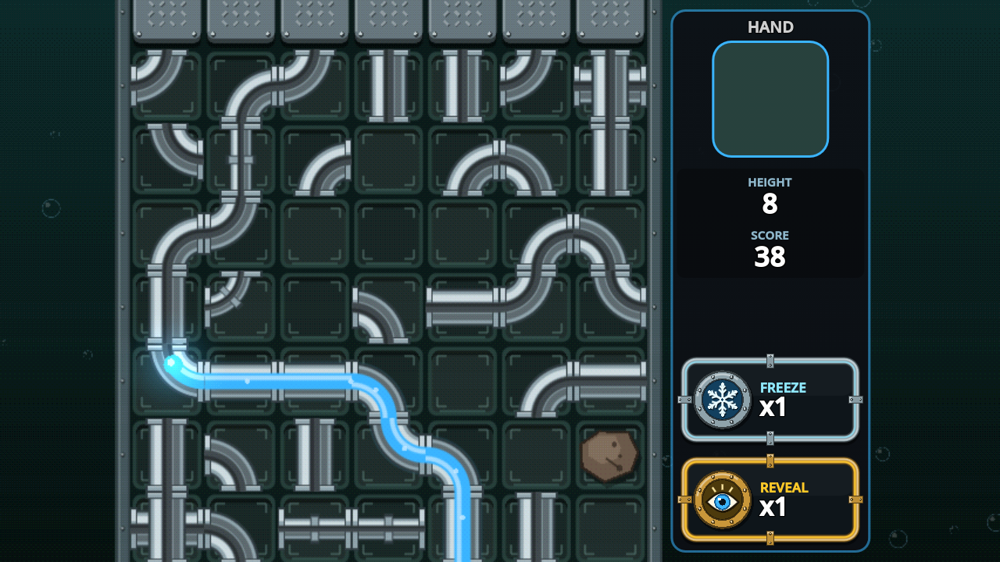
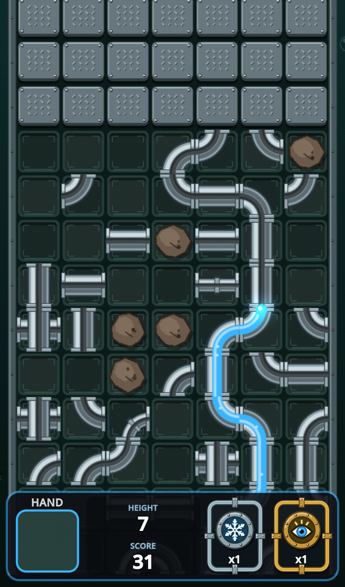

# UPSTREAM

**The pump is running. The water is coming. Open the way up.**

### [▶ Play Upstream in your browser](https://zzzteph.github.io/upstream/)

Free, no download, no account. Works on desktop and on phones.

## About the game

Deep under the city, an old pump station has woken up, and the water only goes one way: **up**.

Upstream is an endless pipe-hacking puzzle. Every tile in the shaft starts as a sealed steel hatch. Crack the hatches open to see what's behind them, then swap the pipes around to build a route before the water gets there. If it reaches a dead end, a rock or a hatch you haven't opened, the station floods and your run is over.

The pump's pressure gauge counts down to the first surge. After that, the water never stops, and it speeds up a little with every row it climbs, up to eight times as fast by row 800. You can see the pace in the bubbles streaming up behind the board. How far up can you keep it going?

## Features

- **Endless vertical climb.** The shaft is generated as you rise, and every row is guaranteed to have a way through. If you spill, it's on you.
- **Crack it open, then plan.** Tap a hatch to flip it. Behind it you might find a pipe, an empty slot or a rock. Tap a pipe, then tap where it should go. Closed hatches are light, raised steel, and empty slots are dark sockets, so you can always tell them apart.
- **Buy yourself time.** Narrow pipes and reservoirs slow the water down, so drag them onto its path when things get tight.
- **Hold to hurry.** Route ready? Hold your finger on the screen and the water rushes ahead at four times the speed, with every tube scoring double. Keep holding and it builds: each tube adds another 10%, up to 8x the speed and 4x the points. Let go to slow it back down, but the next hold starts from the bottom again.
- **Second chance.** In the Android app, once per run, you can watch an ad after a leak: the water stops right where it leaked and freezes, so you can fix the pipe and keep climbing.
- **Emergency powers.** Every run starts with one **Flow-freeze**, which locks every pipe in ice and stops the water cold, and one **Reveal**, which flips every hatch on screen open in one wave. You earn another of each every 100 rows.
- **A shaft that fights back.** As you climb, you'll meet more rocks and one-way valves that only let water through from one side.
- **Zone after zone.** Every 50 rows takes you into a new zone with its own look, from Zone 1 all the way to Zone 255.
- **Straightforward scoring.** +1 for every tube the water fills, +2 while you hold to hurry. Climbing doesn't score by itself and there are no bonus pickups, so your score only ever reflects how well you played. Your best score is saved and shown on the main menu.
- **Learn in a minute.** Your first game starts on a specially prepared board with a short walkthrough: open the hatch above the pump, find the pipe it needs, put it in place, and you're off.
- **SOLVER.** Curious how far it can go? Tap SOLVER on the menu and watch a bot play the way a person would, one tap at a time. It opens hatches, snakes the pipe from wall to wall, plans around rocks, rebuilds when a route goes wrong, slips narrow pipes in front of the water to buy time, and saves Freeze and Reveal for when they matter. It only uses what it can see. Solver games don't count toward your best score.
- **Made for phones.** One-thumb touch controls and a portrait layout with every control in one bar along the bottom, plus haptics where your phone supports them.
- **A pump-station look.** Steel plates, rivets, hazard stripes and glowing water, with a subtle PS1-era finish.

## How to play

1. Press **NEW GAME**. The gauge on the pump counts down to the first surge.
2. **Tap a hatch** in the water's way to open it.
3. **Tap a pipe**, then **tap an empty slot or another pipe** to move or swap it. Tap the pipe again to put it back.
4. Build a connected route upward and stay ahead of the water.
5. **Hold anywhere** on the screen to speed the water up once your route is ready. Tubes score 2x while you hold, rising 10% per tube up to 4x.

Your height, score, the pause button, Flow-freeze and Reveal are in the side panel (at the bottom on a phone). While a freeze runs, the Freeze button counts down the seconds until the water moves again. You score **+1 for every tube** the water fills (a cross it passes through both ways counts twice), and **2x to 4x** while you hold to hurry. When the water finally spills, the game-over screen shows your score, height, best score and how fast you played: your average actions per second. Long, winding pipes score more than short straight ones.

**Keyboard:** use the arrows or WASD to move the cursor and Space or Enter to tap. Hold F to speed up. Q is Flow-freeze, E is Reveal, and P (or the pause button) pauses.

## System requirements

A modern browser with WebGL 2: Chrome, Edge, Firefox or Safari, on desktop, Android or iOS.

---

Built with Godot 4. All art and sound are generated in code. To build it, run it locally or change the game's balance, see [DEVELOPMENT.md](DEVELOPMENT.md).
